# v3.2 figure catalog

Main detector comparisons use primary complete frames. The extreme example and manipulation checks use all approved available pairs. When no complete frames exist, graph 07 explicitly shows exploratory available-pair association. Intervals resample frames, not model-condition rows. No missing outcome is replaced with zero.

## Source and cohort flow

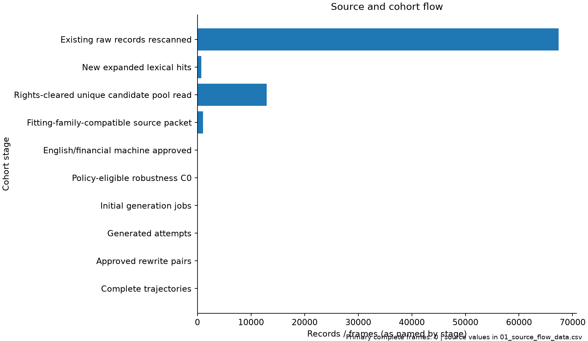

Question: How many records reach each cohort stage?

Observation: Existing raw records rescanned: 67380; New expanded lexical hits: 707; Rights-cleared unique candidate pool read: 12954; Fitting-family-compatible source packet: 1065; English/financial machine approved: 16; Policy-eligible robustness C0: 12; Initial generation jobs: 48; Generated attempts: 89; Approved rewrite pairs: 14; Complete trajectories: 0

Allowed: Counts describe cohort selection; consult stage units.

Do not claim: Selection counts do not establish population prevalence.

Data: [CSV](figures/01_source_flow_data.csv). Audit: [metadata](figures/01_source_flow_metadata.json).

## Condition completeness

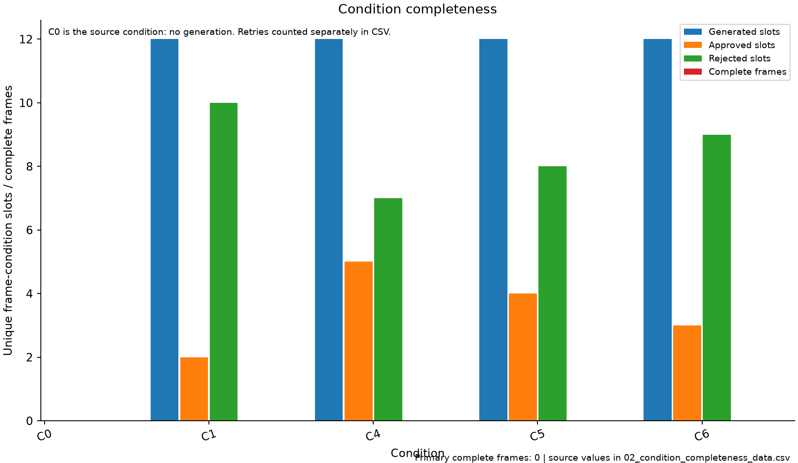

Question: Which conditions are available and included in the paired cohort?

Observation: 0 frames are retained in every condition. Generated/approved/rejected counts deduplicate retries; rejected means no approved attempt for that slot.

Allowed: Availability and attempts are separate quantities; attempt_count and retry_count are exported separately. C0 has no generated slots.

Do not claim: A missing condition is never a zero detector score.

Data: [CSV](figures/02_condition_completeness_data.csv). Audit: [metadata](figures/02_condition_completeness_metadata.json).

## Recall by condition

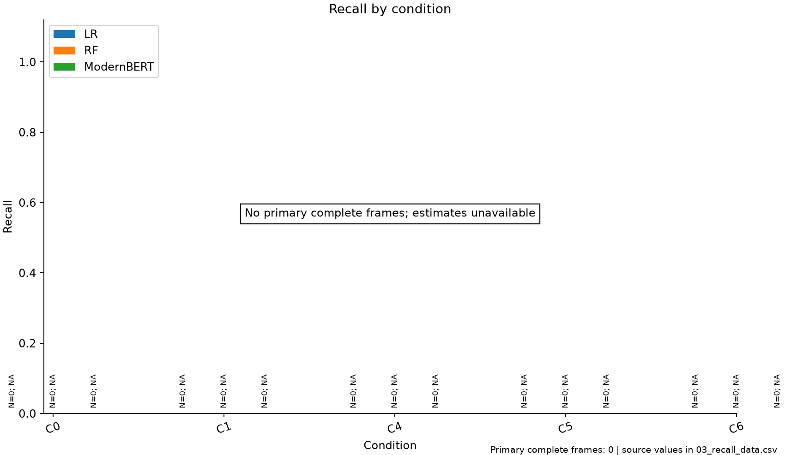

Question: How does recall vary by model and condition?

Observation: No primary complete frames; estimates are unavailable. Denominators are explicitly shown for true_label=1; undefined rates remain missing.

Allowed: Rates compare the same complete frames within each true-label stratum.

Do not claim: These rates do not estimate deployment prevalence or causal effects.

Data: [CSV](figures/03_recall_data.csv). Audit: [metadata](figures/03_recall_metadata.json).

## False positive rate by condition

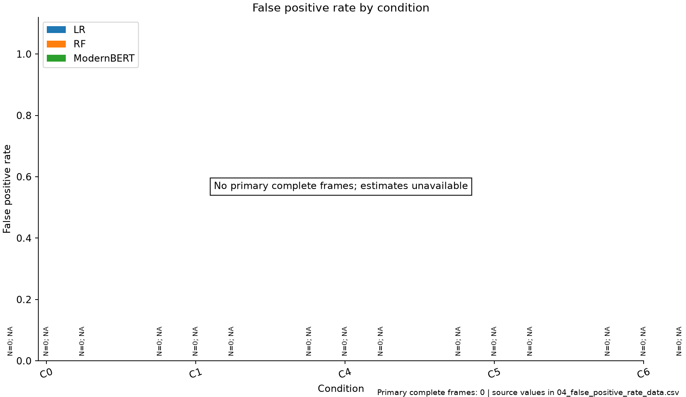

Question: How does false positive rate vary by model and condition?

Observation: No primary complete frames; estimates are unavailable. Denominators are explicitly shown for true_label=0; undefined rates remain missing.

Allowed: Rates compare the same complete frames within each true-label stratum.

Do not claim: These rates do not estimate deployment prevalence or causal effects.

Data: [CSV](figures/04_false_positive_rate_data.csv). Audit: [metadata](figures/04_false_positive_rate_metadata.json).

## Signed phishing-probability movement (P0 − Pi)

Question: How large is paired movement relative to C0 within each true class?

Observation: No primary complete frames; estimates are unavailable. Legitimate and phishing observations are labelled separately; a class with N=0 has no estimate. Positive signed movement means lower phishing probability than C0. Intervals resample frames with seed 42.

Allowed: This describes paired score sensitivity within each class for retained frames.

Do not claim: Probability movement alone does not establish evasion, correctness, or semantic equivalence.

Data: [CSV](figures/05_signed_delta_data.csv). Audit: [metadata](figures/05_signed_delta_metadata.json).

## Absolute phishing-probability movement |P0 − Pi|

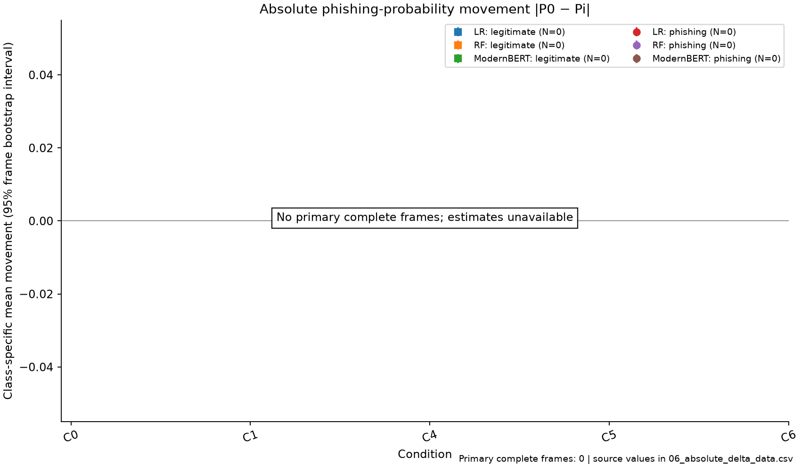

Question: How large is paired movement relative to C0 within each true class?

Observation: No primary complete frames; estimates are unavailable. Legitimate and phishing observations are labelled separately; a class with N=0 has no estimate. Positive signed movement means lower phishing probability than C0. Intervals resample frames with seed 42.

Allowed: This describes paired score sensitivity within each class for retained frames.

Do not claim: Probability movement alone does not establish evasion, correctness, or semantic equivalence.

Data: [CSV](figures/06_absolute_delta_data.csv). Audit: [metadata](figures/06_absolute_delta_metadata.json).

## Surface distance versus score movement (available pairs; exploratory)

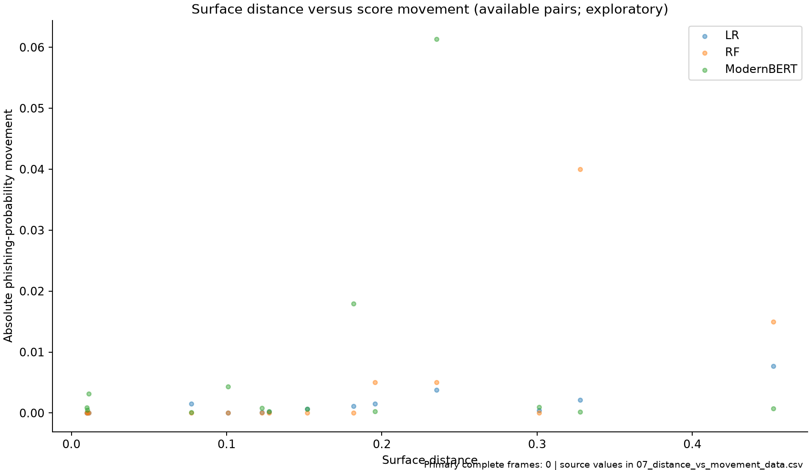

Question: Do larger surface changes accompany larger score changes?

Observation: 42 model-variant observations have surface distance; missing distances are omitted from marks.

Allowed: The plot describes association, with repeated observations belonging to frames. When the primary cohort is empty, these are explicitly exploratory available-pair observations.

Do not claim: Association is not causation; surface distance is not semantic distance. Available-pair observations are not complete-cohort inference.

Data: [CSV](figures/07_distance_vs_movement_data.csv). Audit: [metadata](figures/07_distance_vs_movement_metadata.json).

## Four threshold-transition types

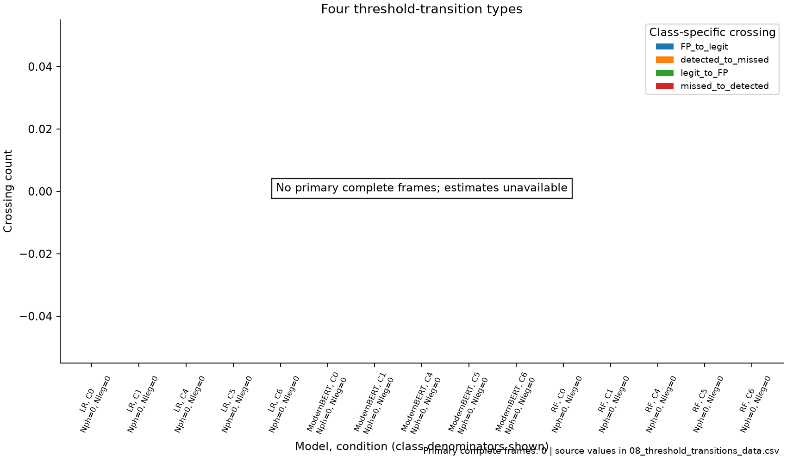

Question: Which paired predictions cross the detector threshold?

Observation: No primary complete frames; estimates are unavailable. Four class-specific crossings are counted: detected→missed and missed→detected for phishing; legitimate→false-positive and false-positive→legitimate for legitimate messages. Unchanged predictions are excluded.

Allowed: N is the class denominator; eligible_N is the baseline state at risk of each crossing; absent-class rates remain unavailable.

Do not claim: Do not combine phishing misses and legitimate false positives as a single evasion measure.

Data: [CSV](figures/08_threshold_transitions_data.csv). Audit: [metadata](figures/08_threshold_transitions_metadata.json).

## Representative complete frame (nearest median mean absolute movement): unavailable

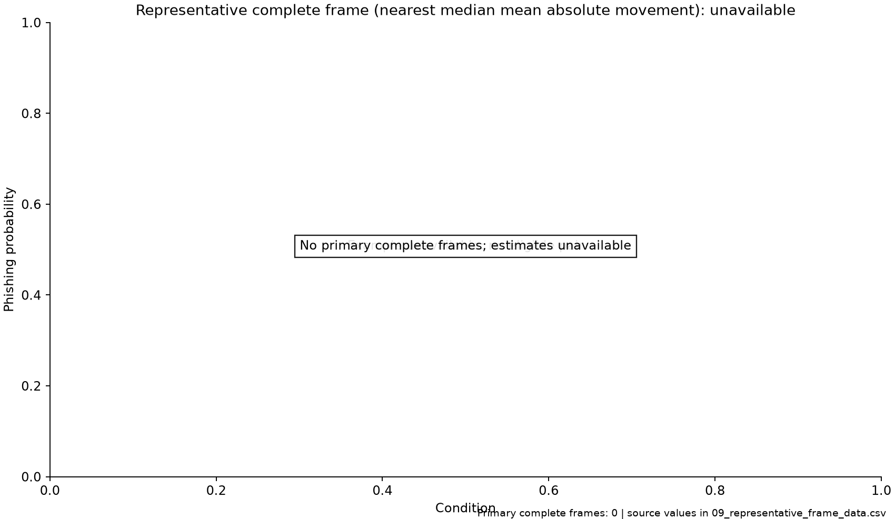

Question: Is a paired frame available to illustrate?

Observation: No primary complete frames; estimates are unavailable. No eligible nonbaseline pair is available for example selection.

Allowed: An unavailable example must remain unavailable.

Do not claim: Do not substitute a frame outside the stated selection cohort.

Data: [CSV](figures/09_representative_frame_data.csv). Audit: [metadata](figures/09_representative_frame_metadata.json).

## EXTREME CASE—NOT REPRESENTATIVE

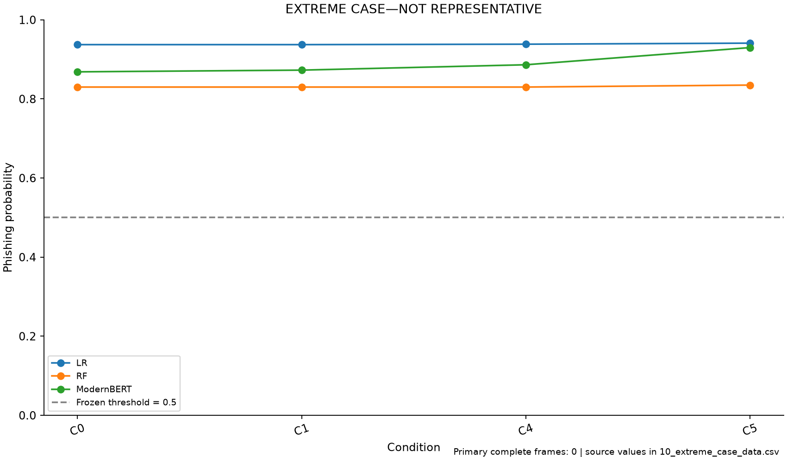

Question: What does a concrete paired frame look like?

Observation: Strongest single pair among all approved available pairs: frame nus-5294, ModernBERT, C5, |Δ|=0.0613; frame complete-case membership=False. EXTREME CASE—NOT REPRESENTATIVE.

Allowed: This illustrates the stated selection rule; exact before/after text, model probabilities, true labels, and the frozen threshold are exported.

Do not claim: A single frame cannot establish overall model performance or population effects.

Data: [CSV](figures/10_extreme_case_data.csv). Audit: [metadata](figures/10_extreme_case_metadata.json).

Before text:

Dear Customer,Someone is trying to add card ending  <#>  on mChek. If you believe the card might be used by someone else,please notify your bank.

Condition texts:

- C0 (true_label=0): Dear Customer,Someone is trying to add card ending  <#>  on mChek. If you believe the card might be used by someone else,please notify your bank.
- C1 (true_label=0): Dear Customer,Someone is attempting to add card ending  <#>  on mChek. If you believe the card may be used by someone else,please notify your bank.
- C4 (true_label=0): Dear Customer,Someone is attempting to add the card ending  <#>  on mChek. If you think the card may be being used by someone else,please notify your bank.
- C5 (true_label=0): Dear Customer, someone is trying to add card ending <#> on mChek. If you think someone else may be using the card, please notify your bank.

Model probabilities:

- LR, C0: P0=0.93727929, Pi=0.93727929, P0−Pi=0.00000000, prediction=1
- LR, C1: P0=0.93727929, Pi=0.93727929, P0−Pi=0.00000000, prediction=1
- LR, C4: P0=0.93727929, Pi=0.93841173, P0−Pi=-0.00113244, prediction=1
- LR, C5: P0=0.93727929, Pi=0.94103408, P0−Pi=-0.00375479, prediction=1
- RF, C0: P0=0.83000000, Pi=0.83000000, P0−Pi=0.00000000, prediction=1
- RF, C1: P0=0.83000000, Pi=0.83000000, P0−Pi=0.00000000, prediction=1
- RF, C4: P0=0.83000000, Pi=0.83000000, P0−Pi=0.00000000, prediction=1
- RF, C5: P0=0.83000000, Pi=0.83500000, P0−Pi=-0.00500000, prediction=1
- ModernBERT, C0: P0=0.86848533, Pi=0.86848533, P0−Pi=0.00000000, prediction=1
- ModernBERT, C1: P0=0.86848533, Pi=0.87282342, P0−Pi=-0.00433809, prediction=1
- ModernBERT, C4: P0=0.86848533, Pi=0.88639009, P0−Pi=-0.01790476, prediction=1
- ModernBERT, C5: P0=0.86848533, Pi=0.92983019, P0−Pi=-0.06134486, prediction=1

## Manipulation-check distance distributions

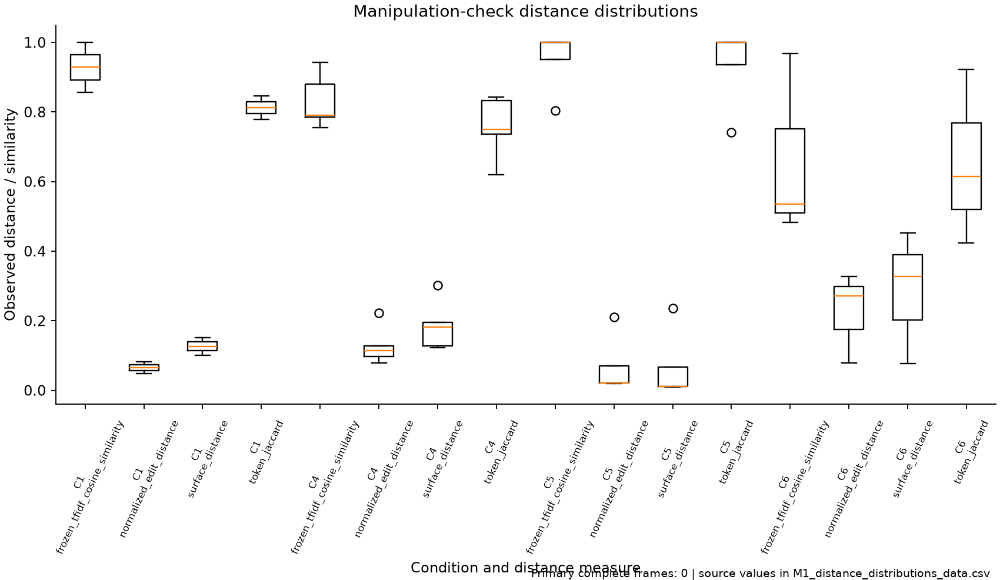

Question: How much surface variation did each condition produce?

Observation: Distributions retain each metric's definition; unavailable values are omitted and observed N is exported.

Allowed: TF-IDF cosine is lexical feature similarity; Jaccard and edit measures describe surface changes.

Do not claim: Lexical cosine similarity must not be described as semantic preservation.

Data: [CSV](figures/M1_distance_distributions_data.csv). Audit: [metadata](figures/M1_distance_distributions_metadata.json).

## Semantic preservation versus surface distance

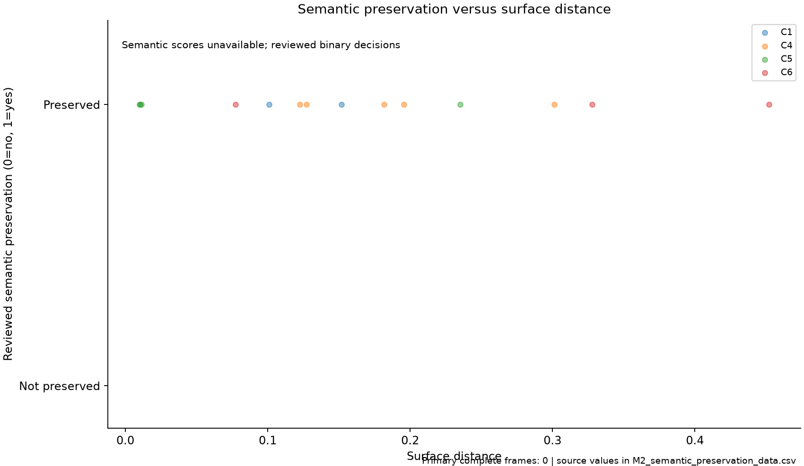

Question: Were meanings preserved across the observed surface changes?

Observation: Semantic similarity scores are unavailable. This plot uses reviewed preservation decisions as a binary outcome, without inventing semantic scores.

Allowed: Reviewed binary decisions and recorded similarity scores are distinct evidence types.

Do not claim: Neither lexical cosine nor missing semantic scores are evidence of semantic equivalence.

Data: [CSV](figures/M2_semantic_preservation_data.csv). Audit: [metadata](figures/M2_semantic_preservation_metadata.json).
