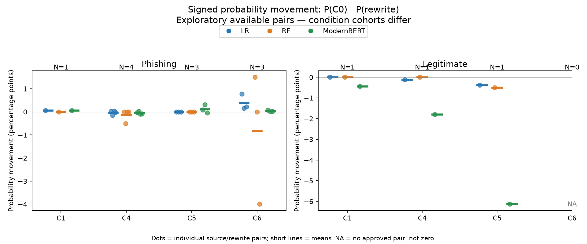
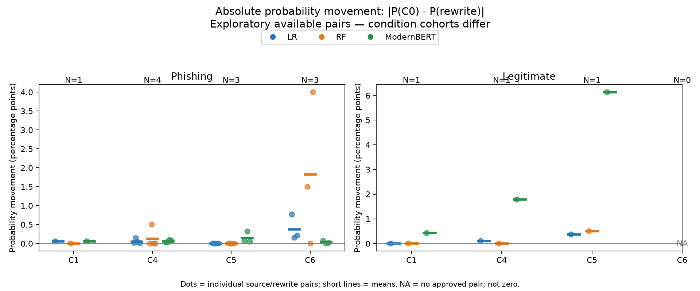
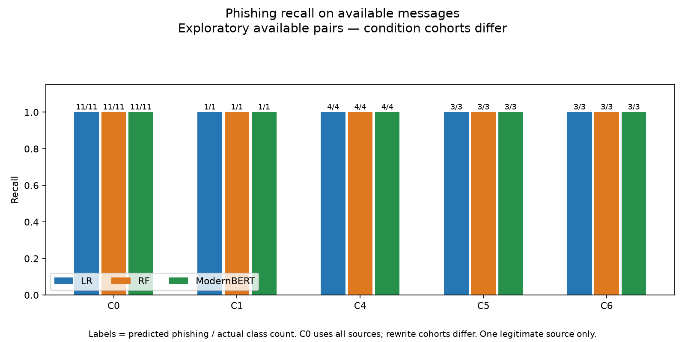
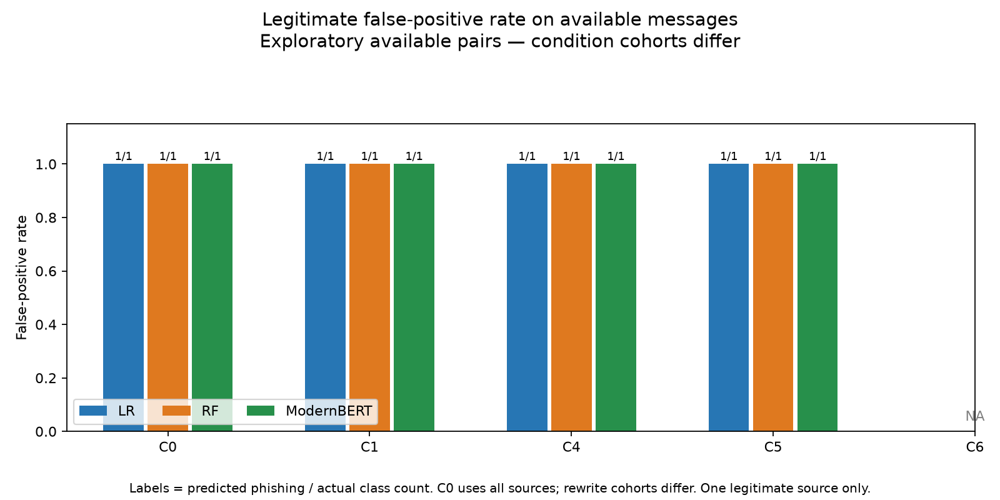
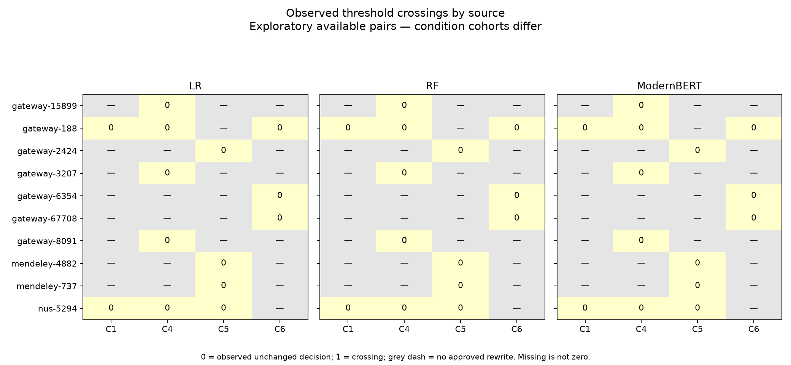
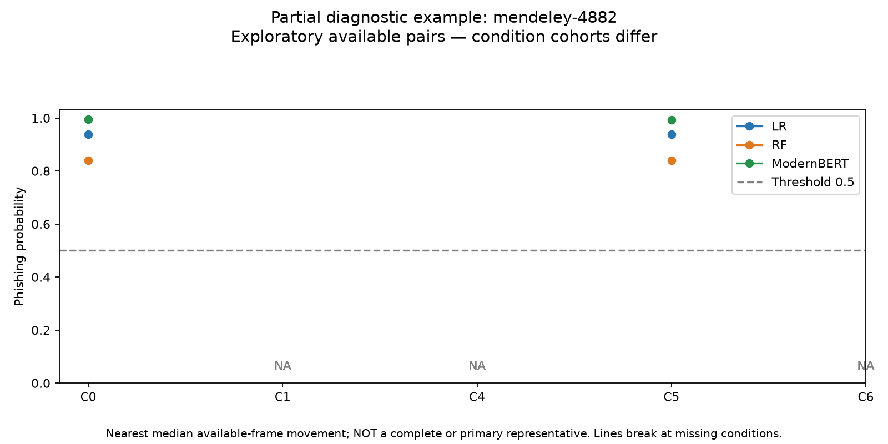

# Graphs with observed data — exploratory available pairs

These plots show actual approved pairs, not the unavailable complete-case analysis. Condition cohorts differ. Points are individual source frames; no confidence interval is invented for one frame. The original frozen primary figures are preserved.

## Signed probability movement: P(C0) - P(rewrite)

Dots = individual source/rewrite pairs; short lines = means. NA = no approved pair; not zero.

[PNG](figures_available_pairs/05_signed_movement.png) · [SVG](figures_available_pairs/05_signed_movement.svg) · [Exact data](figures_available_pairs/05_signed_movement_data.csv)

## Absolute probability movement: |P(C0) - P(rewrite)|

Dots = individual source/rewrite pairs; short lines = means. NA = no approved pair; not zero.

[PNG](figures_available_pairs/06_absolute_movement.png) · [SVG](figures_available_pairs/06_absolute_movement.svg) · [Exact data](figures_available_pairs/06_absolute_movement_data.csv)

## Phishing recall on available messages

Labels = predicted phishing / actual class count. C0 uses all sources; rewrite cohorts differ. One legitimate source only.

[PNG](figures_available_pairs/03_recall.png) · [SVG](figures_available_pairs/03_recall.svg) · [Exact data](figures_available_pairs/03_recall_data.csv)

## Legitimate false-positive rate on available messages

Labels = predicted phishing / actual class count. C0 uses all sources; rewrite cohorts differ. One legitimate source only.

[PNG](figures_available_pairs/04_false_positive_rate.png) · [SVG](figures_available_pairs/04_false_positive_rate.svg) · [Exact data](figures_available_pairs/04_false_positive_rate_data.csv)

## Observed threshold crossings by source

0 = observed unchanged decision; 1 = crossing; grey dash = no approved rewrite. Missing is not zero.

[PNG](figures_available_pairs/08_observed_crossings.png) · [SVG](figures_available_pairs/08_observed_crossings.svg) · [Exact data](figures_available_pairs/08_observed_crossings_data.csv)

## Partial diagnostic example: mendeley-4882

Nearest median available-frame movement; NOT a complete or primary representative. Lines break at missing conditions.

[PNG](figures_available_pairs/09_partial_example.png) · [SVG](figures_available_pairs/09_partial_example.svg) · [Exact data](figures_available_pairs/09_partial_example_data.csv)

## Additional observed plots

[Distance versus movement](figures/07_distance_vs_movement.png) · [Extreme case](figures/10_extreme_case.png) · [Manipulation distances](figures/M1_distance_distributions.png) · [Reviewed preservation](figures/M2_semantic_preservation.png)
